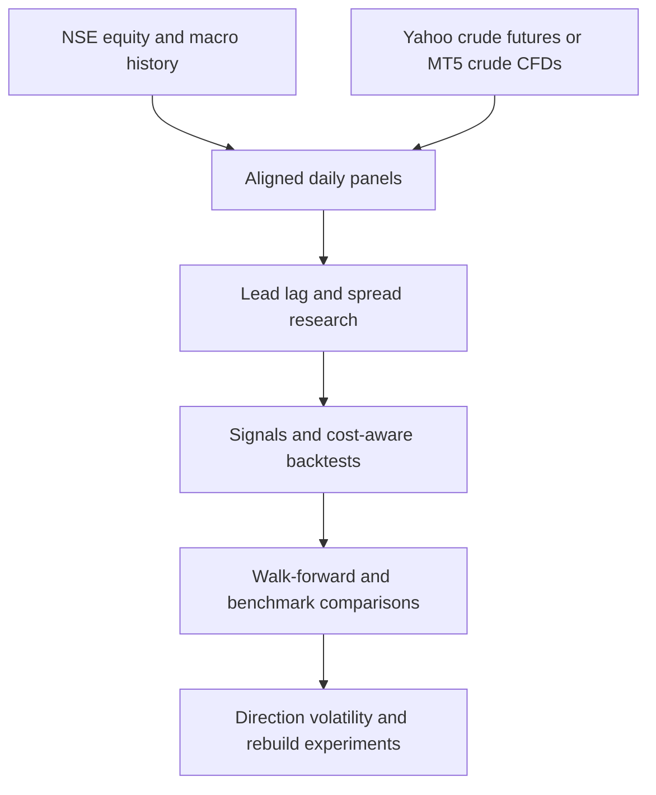

# Crude Oil Strategy Research

Cross-asset research on Brent/WTI crude signals and Indian oil equities, covering feed alignment, predictive relationships, transaction costs, walk-forward evaluation and volatility targeting.

The research universe includes oil-marketing companies IOC, HINDPETRO and BPCL, upstream producers ONGC and OIL, plus benchmark and currency context. These relationships are hypotheses to test, not guaranteed trading edges.

## Research workflow



The two crude feeds remain separate because instrument definitions, history coverage and bar boundaries differ. The diagram describes the components, not an automated approval pipeline.

## Source guide

| Component | Files |
|---|---|
| Instrument mappings and sample dates | `config/instruments.py` |
| Data acquisition | `src/fetch_nse.py`, `fetch_crude_yf.py`, `fetch_crude.py`, `fetch_products.py` |
| Feed comparison and panel construction | `src/validate_crude.py`, `src/build_panel.py` |
| Lead/lag and spread research | `src/phase1_ic.py`, `phase1b_spread.py`, `phase1c_crack.py` |
| Strategy and cost experiments | `src/strategy.py`, `phase2_backtest.py`, `phase2b_lookback.py`, `phase2c_feed_conflict.py` |
| Walk-forward and risk comparisons | `src/phase3_walkforward.py`, `phase3b_benchmark.py`, `phase3c_voltarget.py` |
| Direction and rebuild experiments | `src/phase4_direction.py`, `src/phase5_rebuild.py` |
| Visualization export | `src/viz_export.py` |
| Archived methodological findings | `research/` |

Filenames in each row after the first share the same directory prefix.

## Setup

Use a modern Python 3 environment. Minimum-version compatibility and a clean installation have not been verified for this release.

```powershell
python -m venv .venv
.venv\Scripts\python -m pip install -r requirements.txt
```

On macOS/Linux use `.venv/bin/python`. For optional MT5 acquisition on Windows, install `requirements-mt5.txt` and use an appropriately configured, logged-in local terminal. No credentials or terminal state are shipped.

## Data preparation

Run from the repository root. Inspect `config/instruments.py` first: instrument symbols and sample dates are research defaults, including a fixed historical end date. Fetchers contact external providers and write local data; confirm permitted use before running.

```powershell
.venv\Scripts\python src/fetch_nse.py
.venv\Scripts\python src/fetch_crude_yf.py
.venv\Scripts\python src/build_panel.py yf
.venv\Scripts\python src/phase1_ic.py yf
```

For a separate MT5 comparison, acquire crude using `src/fetch_crude.py`, build the `mt5` panel, and run `src/validate_crude.py` once both feeds exist. The refining-product experiments also require `src/fetch_products.py` outputs. Inspect individual scripts for further prerequisites before progressing to backtests and plots.

Raw files are expected under `data/raw/`; aligned panels are written under `data/processed/`. Reports and figures go to `outputs/`. These directories are intentionally excluded. A clone does not include ready-to-run historical datasets or prior results.

## Timing and interpretation

Daily crude closes can become available after the NSE cash close. The panel builder uses an availability-date convention and backward matching rather than a naive same-date join. Independently validate this convention for your provider, timezone and execution assumptions; it is not a universal feed guarantee.

Research notes record changes of hypothesis, unsuccessful experiments and reported results. They are preserved as author research history, not independently verified performance. Some notes refer to local plots or outputs that are not distributed. The original notes report repeated examination of the 2024–2026 period; do not describe it as an untouched holdout.

## Limitations

- No reported return, Sharpe ratio or statistical significance has been reproduced for this publication.
- A small, correlated equity universe limits independent evidence.
- Costs, overnight exposure, corporate actions, policy shifts and futures/CFD differences can materially affect results.
- Configuration and source comments reflect the original research assumptions, not verified current broker terms or facts.
- Source syntax and selected-file secret checks passed. Dependency installation, downloads, MT5 integration and full experiments remain unverified.

## Publication scope

Included: research source, instrument configuration, archived Markdown notes and setup documentation. Excluded: datasets, generated outputs, notebooks, caches, credentials, broker sessions and local Git history. A broker-server label was removed from the publication configuration comment; the original local project is unchanged. No broker login or trading operation was performed.

## License

No open-source license has been assigned. Public visibility alone does not grant general reuse or redistribution rights.
